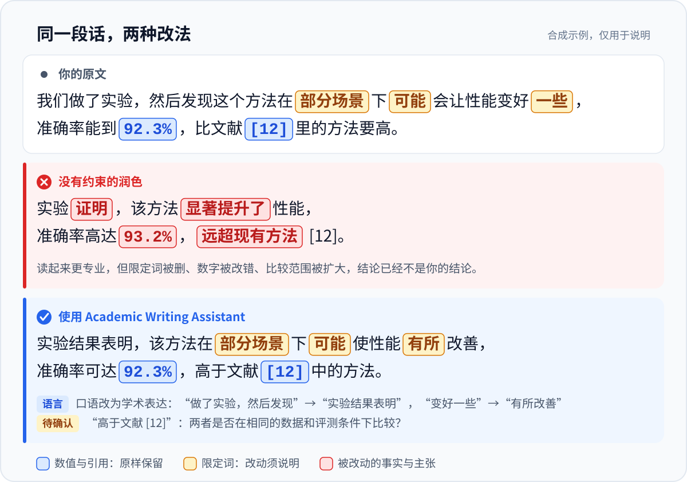

<div align="center">

<picture>
  <source media="(prefers-color-scheme: dark)" srcset="assets/logo/revision-compass-dark.svg">
  
</picture>

# Academic Writing Assistant

### 让 AI 帮你改论文，但不改你的数据和结论

适用于各学科的**学术写作 Skill**：论文润色 · 中英互译 · 章节起草 · 学位论文与基金申请 · 审稿回复 · 投稿材料<br>
一份 Skill，可在 Claude Code、Codex、Cursor、Grok Build、OpenCode、WorkBuddy 中使用。

[](CHANGELOG.md)
[](LICENSE)
[](https://github.com/LvvUP/academic-writing-assistant/actions/workflows/ci.yml)
[](https://agentskills.io)
[](https://github.com/LvvUP/academic-writing-assistant/stargazers)

**中文** · [English](README_EN.md)

[快速安装](#快速安装) · [效果示例](#效果示例) · [功能一览](#功能一览) · [适用学科](#适用学科) · [支持的平台](#支持的平台) · [升级](#升级) · [常见问题](#常见问题)

</div>

<p align="center">
  
</p>

用 AI 改论文，语法和流畅度往往不是问题。真正危险的是那些**读起来更好、却悄悄改变了事实**的修改。

Academic Writing Assistant 给 AI 一份**保真契约**：语言可以大胆改，事实与证据边界不能动；涉及主张强度的修改必须单独列出，由你决定是否采用。

## 快速安装

把下面这段话发给你的 AI Agent，它会完成下载、安装和验证。适用于 **Claude Code、Codex、Cursor、Grok Build、OpenCode**；WorkBuddy 请用[下方的专用提示词](#workbuddy)。

```text
请帮我安装（已安装则更新）学术写作 Skill「academic-writing-assistant」，全程只用仓库自带的安装脚本：
1. 判断你是哪个 Agent，确定 --host：Claude Code → claude，Codex → codex，Cursor → cursor，Grok Build → grok-build，OpenCode → opencode。不是这五个就告诉我并停止。
2. 把 https://github.com/LvvUP/academic-writing-assistant（main 分支）git clone --depth 1 到一个临时文件夹，在其中运行（需 Python 3.9+；Windows 可用 py -3 代替 python3）：
   python3 -B scripts/install_skill.py install --host <上面的值> --home-root "$HOME"
3. 如果提示已安装，把 install 换成 update 再运行；如果提示需要 --backup-existing，加上它再运行（旧副本会移到备份文件夹，不会删除）。遇到其他错误就原样告诉我并停止：不要手动复制或删除文件、不要绕过检查、不要用 sudo。
4. 验证：把上面命令里的 install 换成 verify 再运行一次，应输出 verified 和版本号。
5. 删除临时文件夹，把安装路径、版本、备份位置（如有）和脚本输出的 note 提示告诉我，并说明调用方式、是否需要新开会话。
```

以后想更新，再发送一次同样的话即可。

### WorkBuddy

WorkBuddy 通过「上传技能」导入自备的技能包：先让它准备技能包，再由你上传。

<details>
<summary><strong>发给 WorkBuddy 的提示词与上传步骤</strong></summary>

```text
请帮我准备学术写作 Skill「academic-writing-assistant」的技能包，我要通过「上传技能」把它装进 WorkBuddy：
1. 把 https://github.com/LvvUP/academic-writing-assistant（main 分支）git clone --depth 1 到当前工作空间里的一个临时文件夹。
2. 在该文件夹中运行（需 Python 3.9+；Windows 可用 py -3 代替 python3；把 <工作空间> 换成当前工作空间的绝对路径）：
   python3 -B scripts/install_skill.py export --destination "<工作空间>/awa-package/academic-writing-assistant" --archive
   它会生成技能文件夹 awa-package/academic-writing-assistant 和压缩包 awa-package/academic-writing-assistant.zip。如果提示已存在，说明以前导出过：先告诉我，由我决定是否删除旧的 awa-package 文件夹后重试。遇到其他错误就原样告诉我并停止，不要手动拼装文件。
3. 验证：确认压缩包第一层有 SKILL.md，并读出其中 metadata 下的 version。
4. 删除第 1 步的临时文件夹（保留 awa-package），把压缩包和技能文件夹的完整路径、版本号告诉我，并提醒我接下来到「专家·技能·连接器 → 技能 → 添加技能 → 上传技能」选中这个压缩包。
```

然后在 WorkBuddy 中：

1. 左侧边栏点击 **专家·技能·连接器**，选中 **技能** 页签。
2. 点击 **添加技能 → 上传技能**，拖入或选中 `academic-writing-assistant.zip`。官方文档只说“选中本地技能包”，没有说明格式；如果压缩包不被接受，可以改试同一目录下内容相同的 `academic-writing-assistant` 文件夹。
3. 列表里已有旧版本时，先在「已安装」中卸载旧版本，再上传新包。

不想运行命令时，也可以在 [Releases 页面](https://github.com/LvvUP/academic-writing-assistant/releases) 下载最新版本附带的 `academic-writing-assistant.zip`，直接上传。

> 这一流程依据 WorkBuddy [官方文档](https://www.codebuddy.cn/docs/workbuddy/From-Beginner-to-Expert-Guide/Function-Description/Skills-Market)描述的「上传技能」方式编写，各项说法的出处见 [兼容说明](docs/compatibility.md)。遇到问题请 [提交 Issue](https://github.com/LvvUP/academic-writing-assistant/issues)。

</details>

<details>
<summary><strong>备选：自己在终端运行同一个脚本</strong></summary>

需要 Git 和 Python 3.9+：

```sh
git clone --depth 1 https://github.com/LvvUP/academic-writing-assistant.git
cd academic-writing-assistant
python3 -B scripts/install_skill.py install --host claude --home-root "$HOME"
python3 -B scripts/install_skill.py verify --host claude --home-root "$HOME"
```

把 `claude` 换成你使用的 Agent：

| Agent | `--host` | 安装位置 |
|---|---|---|
| Claude Code | `claude` | `~/.claude/skills/academic-writing-assistant` |
| Codex | `codex` | `~/.agents/skills/academic-writing-assistant` |
| Cursor | `cursor` | `~/.cursor/skills/academic-writing-assistant` |
| Grok Build | `grok-build` | `~/.grok/skills/academic-writing-assistant` |
| OpenCode | `opencode` | `~/.config/opencode/skills/academic-writing-assistant` |

为 WorkBuddy 导出技能包：

```sh
python3 -B scripts/install_skill.py export --destination "$HOME/awa-package/academic-writing-assistant" --archive
```

更新时把 `install` 换成 `update`，卸载用 `uninstall`。Windows 可用 `py -3` 代替 `python3`。提示词安装和终端安装用的是同一个脚本，装出来的副本可以互相更新。更多说明见 [安装指南](docs/installation.md)。

</details>

### 确认安装成功

安装脚本的 `verify` 会核对已安装的文件。要确认 Agent 已经加载：

| 平台 | 怎么确认 |
|---|---|
| Claude Code | 输入 `/`，列表中有 `academic-writing-assistant` |
| Codex | 运行 `/skills`，或输入 `$` 后能选到它 |
| Cursor | 在 Agent 输入框输入 `/`，搜索 `academic-writing-assistant` |
| Grok Build | 运行 `/skills` 查看，或输入 `/academic-writing-assistant` |
| OpenCode | 在提示中写 `@academic-writing-assistant`，或直接提出写作任务 |
| WorkBuddy | 「专家·技能·连接器 → 技能 → 已安装」中能看到它 |

没有出现时新开会话或重启 Agent，详见 [安装指南](docs/installation.md#验证安装成功)。

### 开始使用

直接用自然语言提出写作任务，Agent 会自动调用；也可以显式指定：

```text
/academic-writing-assistant 请润色下面这段摘要，保留数值、引用和结论范围，并说明重要改动。

[粘贴你的文本]
```

> Claude Code、Grok Build 使用 `/academic-writing-assistant`；Codex 使用 `$academic-writing-assistant`；Cursor 在 Agent 输入框输入 `/` 后选择；OpenCode 使用 `@academic-writing-assistant`；WorkBuddy 直接描述任务，或输入 `/` 从技能列表中选择。

## 效果示例

> 以下均为合成示例，数据与引用仅用于演示。

### 论文润色：口语化表达 + 相关被写成因果（社会科学）

**原文**

> 我们对 412 名大学生做了问卷调查，结果发现每天刷短视频的时间越长，学习投入就越低（r = −0.29，p < 0.001）。这说明刷短视频会严重影响大学生的学习，学校应该采取措施进行干预。

**润色后**

> 本研究对 412 名大学生开展问卷调查，发现每日短视频使用时长与学习投入呈负相关（r = −0.29，p < 0.001）。[干预建议：请补充支持因果关系或干预效果的依据后再写入。]

**重要改动**

| 原文 | 修改后 | 层级 | 原因 |
|---|---|---|---|
| 刷短视频会严重影响大学生的学习 | 与学习投入呈负相关 | L3 主张 | 问卷相关分析支持“相关”，不足以支持“影响”和“严重”的判断 |
| 学校应该采取措施进行干预 | 改为待补充占位 | L3 主张 | 该建议依赖因果判断；有干预研究或文献依据时可恢复为条件化建议 |

<details>
<summary><strong>中译英：观察性研究不写成“降低风险”（医学）</strong></summary>

**中文原文**

> 在这项回顾性队列研究中，我们纳入了 2018—2022 年间在本院就诊的 1,236 名 2 型糖尿病患者。与未使用该药物的患者相比，使用该药物的患者心血管事件风险较低（HR = 0.78，95% CI 0.64–0.95），但这一关联在 65 岁及以上患者中不明显。

**英文译文**

> In this retrospective cohort study, we included 1,236 patients with type 2 diabetes who attended our hospital between 2018 and 2022. Compared with non-users, patients who used the drug had a lower risk of cardiovascular events (HR = 0.78, 95% CI 0.64–0.95), although this association was not evident in patients aged 65 years or older.

**译法说明：** “风险较低”译为 *had a lower risk*，而不是 *reduced the risk*，因为队列研究只支持关联；“不明显”译为 *not evident*，不写成 *no effect*。数值、置信区间和年龄界值逐一对应。

</details>

<details>
<summary><strong>中译英：“应当”不能变成“可以”（法学）</strong></summary>

**中文原文（合成条文，非现行法律）**

> 用人单位应当在用工之日起一个月内与劳动者订立书面劳动合同；未订立的，不得以此为由拒绝支付劳动报酬。

**英文译文**

> The employer shall conclude a written employment contract with the employee within one month from the date on which employment begins. Where no such contract has been concluded, the employer shall not refuse to pay remuneration on that ground.

**译法说明：** “应当”对应义务性的 *shall*，“不得”对应 *shall not*，不改为 *should* 或 *may*；期限、起算点和条件关系保持不变。

</details>

<details>
<summary><strong>论文润色：仿真结果不写成“可以直接用于工程”（工程）</strong></summary>

**原文**

> 我们用有限元仿真算了一下，这个支架的最大应力是 182 MPa，比许用应力 235 MPa 小，所以这个结构是安全的，可以直接用到工程上。

**润色后**

> 有限元仿真结果显示，该支架的最大应力为 182 MPa，低于许用应力 235 MPa。

**重要改动（L3）：** “结构是安全的，可以直接用到工程上”超出了一次仿真所能支持的范围。已完成试验验证或规范校核时，请提供依据后再写；否则可写为“在所计算的工况下满足强度要求”，并说明载荷与边界条件。数值与单位保持不变。

</details>

<details>
<summary><strong>审稿回复：只写作者确认已完成的修改（计算机）</strong></summary>

**审稿意见**

> The accuracy gain may come at the cost of higher inference latency.

**作者材料**

> 我们同意需要量化推理开销。已在同一张 GPU、batch size = 1、相同输入分辨率下测量推理延迟：baseline 为 18 ms/图像，我们的方法为 21 ms/图像；准确率分别为 84.2% 和 86.1%。已将这组结果补入修订稿表 4，并在第 5.2 节补充准确率与延迟的权衡。请写成英文期刊回复。

**回复草稿**

> Thank you for raising this point. We have quantified the accuracy–latency trade-off on the same GPU, with a batch size of 1 and the same input resolution. Our method achieves an accuracy of 86.1% at 21 ms per image, compared with 84.2% at 18 ms per image for the baseline. The gain in accuracy comes with higher latency. We have added these results to Table 4 and a discussion of the trade-off to Section 5.2 of the revised manuscript.

**组织方式：** 直接回应问题，给出可比较的结果，再指向已完成的修改。表号、章节和完成状态均来自作者材料，不替作者承诺新实验。

</details>

更多学科的示例见 [examples/](examples/)，包括历史学、经济学、临床医学、材料化学、学位论文与开题报告。

## 功能一览

| 你正在做什么 | 可以交给它的工作 |
|---|---|
| 修改论文 | 中英文润色、扩写、合并段落、按字数压缩、优化标题与贡献表述 |
| 中英互译 | 中译英、英译中，术语对照与重要译法说明，保留 LaTeX 与引用 |
| 起草章节 | 依据你提供的材料组织摘要、引言、文献综述、方法、结果、讨论与结论 |
| 学位论文与申请书 | 学位论文各章、中英文摘要对照、开题报告、基金/项目申请书 |
| 回应审稿 | 期刊逐条回复信、会议 rebuttal，区分已完成修改与计划 |
| 准备投稿 | Cover letter、Highlights、AI 使用声明、CRediT 贡献声明 |
| 引用与格式 | 按 GB/T 7714、APA、MLA、Chicago、IEEE、Vancouver 等整理参考文献；保留 LaTeX 引用、公式与交叉引用 |
| 全文自查 | 跨章节检查术语、缩写、符号、数值与主张是否前后一致 |

## 适用学科

内置 12 个学科大类的写作提示，未列出的学科按通用流程处理，跟随你的学科惯例与论文结构。

| 领域 | 学科大类 |
|---|---|
| 人文社科 | 人文学科 · 法学 · 经济学与管理学 · 社会科学 · 教育学与心理学 |
| 医学与生命科学 | 医学与公共卫生 · 生命科学与农学 |
| 理学 | 物理化学与材料 · 数学与统计 · 地球与环境科学 |
| 工程与计算机 | 工程技术 · 计算机与人工智能 |

**研究类型同样被区分对待：** 实验 · 调查与计量 · 定性研究 · 理论证明 · 综述 · 人文与法学阐释 · 案例研究 · 设计研究

内置示例、术语对照表和章节结构检查都覆盖这些学科与研究类型。它不会要求人文论文写“实验设置”，也不会把访谈主题写成总体比例。

## 支持的平台

| 平台 | 安装方式 | 调用方式 |
|---|---|---|
| Claude Code | 提示词安装到 `~/.claude/skills/` | `/academic-writing-assistant` 或自动调用 |
| Codex | 提示词安装到 `~/.agents/skills/` | `$academic-writing-assistant` 或自动调用 |
| Cursor | 提示词安装到 `~/.cursor/skills/` | 输入 `/` 选择，或自动调用 |
| Grok Build | 提示词安装到 `~/.grok/skills/` | `/academic-writing-assistant` 或自动调用 |
| OpenCode | 提示词安装到 `~/.config/opencode/skills/` | `@academic-writing-assistant` 或自动加载 |
| WorkBuddy | 导出技能包后通过「上传技能」导入 | 直接描述任务，或输入 `/` 选择 |

六个平台使用同一份遵循 [Agent Skills 规范](https://agentskills.io/specification) 的 Skill。各平台的目录、依据的官方文档和同时使用多个 Agent 时的建议见 [兼容说明](docs/compatibility.md)。

## 核心原则：保真契约

| 区域 | 包括什么 | 怎么处理 |
|---|---|---|
| **锁定区** | 数值、单位、p 值、引用、公式、法条、直接引语、伦理批号…… | 原样保留；发现疑似错误只标出，不擅自“更正” |
| **承重语言** | 可能、部分、相关、导致、显著、首次、应当…… | 增强或削弱都要有依据，并单独列出 |
| **自由表层** | 语法、拼写、标点、语序、冗余 | 直接改进 |

所有修改按 **L1 表层 / L2 结构 / L3 主张** 分级：短句纠错直接给结果，较长修订附上重要改动台账，涉及主张的修改不会静默发生。它要拦住的是这类改动：

| 你写的 | 不该出现的“润色” | 问题 |
|---|---|---|
| 该方法**可能**在**部分场景**下改善性能 | 该方法显著提升了性能 | 删掉限定，主张被夸大 |
| A 与 B **相关** | A **导致** B | 相关变成因果 |
| 准确率 92.3% | 准确率 93.2% | 数字被改错 |
| （没有引用） | ……（Smith et al., 2021） | 编造参考文献 |
| 我们**拟**开展问卷调查 | 我们开展了问卷调查 | 计划写成成果 |

**学术诚信：** 它不编造参考文献、数据、实验结果或作者行动，缺失信息用 `[请补充……]` 明确占位；不提供“降低 AI 检测率”或绕过查重的服务。它还会提醒两件需要你自己完成的事：提交前逐条核实参考文献；核对目标期刊、学校或资助机构对使用 AI 工具的现行规定。完整规则见 [SKILL.md](skills/academic-writing-assistant/SKILL.md)。

## 升级

0.5.0 没有改动文件名、目录和安装路径，升级后原有用法不变。

| 你的情况 | 怎么升级 |
|---|---|
| 用安装提示词或安装脚本装的 | 再发送一次[安装提示词](#快速安装) |
| 手动复制或用其他工具装的旧版本 | 同样发送安装提示词；旧副本会被移到备份文件夹（不删除），再装入新版本 |
| WorkBuddy | 重新准备技能包，在「已安装」中卸载旧版本后上传 |

各版本的变化见 [更新记录](CHANGELOG.md)，更多情形见 [安装指南](docs/installation.md#升级)。

## 本地核查工具（可选）

核心写作不需要 Python。如果 Agent 可以运行 Python，还可以用内置脚本做机械核查：

| 脚本 | 用途 |
|---|---|
| `fidelity_check.py` | 比对修改前后的数值、引用、公式、法条序号等是否被改动 |
| `manuscript_audit.py` | 检查缩写首次定义、缺少统计依据的“显著”、字数与字符限制 |
| `terminology_checker.py` | 发现同一概念的不同写法，以及发病率/患病率、定金/订金这类不应混用的概念 |
| `structure_checker.py` | 按研究类型提示摘要、方法、结果等章节可能缺少的要素 |

脚本只使用 Python 标准库，在本地运行、不联网。用法见 [脚本说明](docs/scripts.md)。

## 常见问题

<details>
<summary><strong>会改动我的数据或结论吗？</strong></summary>

不会静默改动。数值、引用、公式属于锁定区；涉及结论强度的修改会在台账中列出并说明理由。发现正文与表格数值不一致时，它会指出冲突，而不是自行选一个。

</details>

<details>
<summary><strong>能帮我降低 AI 检测率或查重率吗？</strong></summary>

不针对检测分数优化，也不承诺任何分数。它可以改善确实存在的空泛、重复、逻辑和引用问题，让文本更具体、更清楚。

</details>

<details>
<summary><strong>我的稿件安全吗？</strong></summary>

本项目的脚本在本地运行、不联网、不收集数据。但你所用的 AI Agent 或云端模型会接收你提供的文本，请按平台和所在机构的数据政策决定提交哪些材料。

</details>

<details>
<summary><strong>没有提供参考文献，能写文献综述吗？</strong></summary>

Agent 有检索能力时，可以实际检索并注明读到了什么；没有检索能力时，会给出结构、检索词和明确的引用占位，不会凭记忆编造文献。无论哪种情况，提交前都需要你自己逐条核实。

</details>

<details>
<summary><strong>用它改论文，需要声明使用了 AI 吗？</strong></summary>

取决于目标期刊、学校或资助机构的现行规定，各处要求不同。它会提醒你核对，并可以按你确认的实际使用情况起草声明，但不替你判断是否合规。

</details>

更多问题见 [FAQ](docs/faq.md)。

## 参与贡献

欢迎补充学科写作惯例、术语对照和合成示例，也欢迎修复脚本问题。请先阅读 [贡献指南](CONTRIBUTING.md)，后续计划见 [路线图](ROADMAP.md)，版本变化见 [更新记录](CHANGELOG.md)。

如果这个 Skill 对你的论文写作有帮助，欢迎点一个 ⭐ **Star**，让更多科研作者发现它。

## 许可

本项目采用 **AGPL-3.0-only** 许可，见 [LICENSE](LICENSE) 与 [许可说明](docs/licensing.md)。
