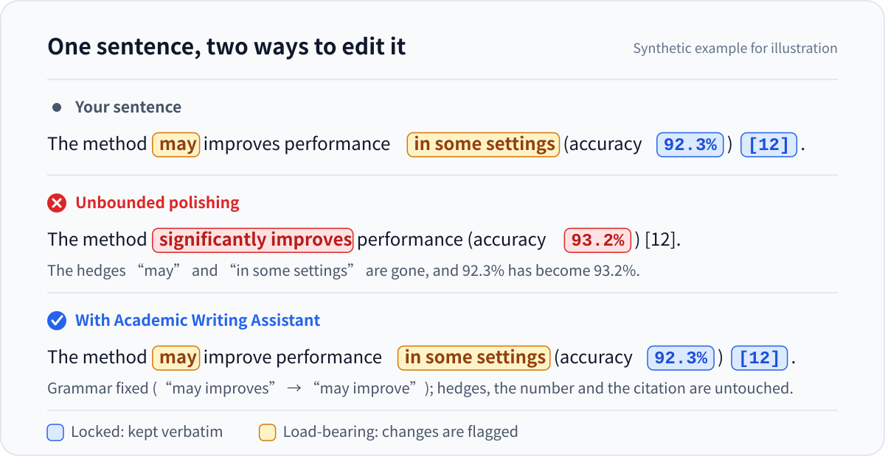

<div align="center">

<picture>
  <source media="(prefers-color-scheme: dark)" srcset="assets/logo/revision-compass-dark.svg">
  
</picture>

# Academic Writing Assistant

### Let AI edit your paper without editing your data or conclusions

An **academic writing Skill for every discipline**, in Chinese and English: polishing · CN↔EN translation · section drafting · theses and grant proposals · reviewer responses · submission materials<br>
One Skill for Claude Code, Codex, Cursor, Grok Build, OpenCode and WorkBuddy.

[](CHANGELOG.md)
[](LICENSE)
[](https://github.com/LvvUP/academic-writing-assistant/actions/workflows/ci.yml)
[](https://agentskills.io)
[](https://github.com/LvvUP/academic-writing-assistant/stargazers)

[中文](README.md) · **English**

[Install](#install) · [Examples](#examples) · [Features](#features) · [Disciplines](#disciplines) · [Supported platforms](#supported-platforms) · [Upgrading](#upgrading) · [FAQ](#faq)

</div>

<p align="center">
  
</p>

Grammar and fluency are rarely the problem when AI edits a paper. The danger is edits that **read better but quietly change the facts**.

Academic Writing Assistant gives your agent a **fidelity contract**: improve the language freely, but never move the facts or the evidence boundary, and list every change to claim strength so you decide whether to accept it.

## Install

Send the message below to your AI agent; it downloads, installs and verifies the Skill. It works for **Claude Code, Codex, Cursor, Grok Build and OpenCode**. For WorkBuddy, use the [separate prompt below](#workbuddy).

```text
Please install (or update, if already installed) the academic writing Skill "academic-writing-assistant", using only the repository's own installer:
1. Work out which agent you are and pick --host: Claude Code → claude, Codex → codex, Cursor → cursor, Grok Build → grok-build, OpenCode → opencode. If you are none of these, tell me and stop.
2. git clone --depth 1 https://github.com/LvvUP/academic-writing-assistant (main branch) into a temporary folder and run there (Python 3.9+; on Windows `py -3` can replace python3):
   python3 -B scripts/install_skill.py install --host <value above> --home-root "$HOME"
3. If it says the Skill is already installed, run it again with update instead of install. If it asks for --backup-existing, add that flag and run again (the old copy is moved to a backup folder, not deleted). For any other error, show it to me and stop: don't copy or delete files by hand, don't bypass the checks, don't use sudo.
4. Verify: run the same command once more with verify instead of install. It should print "verified" and the version.
5. Delete the temporary folder, then tell me the install path, the version, the backup location (if any) and any notes the script printed, plus how to invoke the Skill and whether I need a new session.
```

To update later, send the same message again.

### WorkBuddy

WorkBuddy imports your own Skill packages through its upload dialog: let it prepare the package, then upload it yourself.

<details>
<summary><strong>Prompt for WorkBuddy and upload steps</strong></summary>

```text
Please prepare a package of the academic writing Skill "academic-writing-assistant" so that I can add it to WorkBuddy through "Upload skill" (上传技能):
1. git clone --depth 1 https://github.com/LvvUP/academic-writing-assistant (main branch) into a temporary folder inside the current workspace.
2. In that folder, run (Python 3.9+; on Windows `py -3` can replace python3; replace <workspace> with the absolute path of the current workspace):
   python3 -B scripts/install_skill.py export --destination "<workspace>/awa-package/academic-writing-assistant" --archive
   It creates the Skill folder awa-package/academic-writing-assistant and the archive awa-package/academic-writing-assistant.zip. If it says they already exist, an earlier export is still there: tell me, and I will decide whether to delete the old awa-package folder and retry. For any other error, show it to me and stop; don't assemble the files by hand.
3. Verify: confirm that SKILL.md is at the top level of the archive and read the version under metadata.
4. Delete the temporary folder from step 1 (keep awa-package), tell me the full paths of the archive and the Skill folder and the version, and remind me to upload the archive under 专家·技能·连接器 → 技能 → 添加技能 → 上传技能.
```

Then, in WorkBuddy:

1. Click **专家·技能·连接器** (Experts · Skills · Connectors) in the left sidebar and open the **技能** (Skills) tab.
2. Click **添加技能 → 上传技能** (Add skill → Upload skill) and drop or select `academic-writing-assistant.zip`. The official documentation only says to select a local skill package and does not name a format; if the archive is not accepted, you can try the `academic-writing-assistant` folder next to it, which has the same content (this fallback is not confirmed by the documentation).
3. If an older version is listed, uninstall it under 已安装 (Installed) first, then upload the new package.

If you prefer not to run commands, download `academic-writing-assistant.zip` from the latest release on the [Releases page](https://github.com/LvvUP/academic-writing-assistant/releases) and upload it directly.

> WorkBuddy's documentation does not specify the package format or a local skills directory. These steps follow the upload flow in its [documentation](https://www.codebuddy.cn/docs/workbuddy/From-Beginner-to-Expert-Guide/Function-Description/Skills-Market) (Chinese) and have not been verified against every client version; the English labels in your client may also differ. Please [open an issue](https://github.com/LvvUP/academic-writing-assistant/issues) if the upload fails.

</details>

<details>
<summary><strong>Alternative: run the same installer yourself</strong></summary>

Requires Git and Python 3.9+:

```sh
git clone --depth 1 https://github.com/LvvUP/academic-writing-assistant.git
cd academic-writing-assistant
python3 -B scripts/install_skill.py install --host claude --home-root "$HOME"
python3 -B scripts/install_skill.py verify --host claude --home-root "$HOME"
```

Replace `claude` with your agent:

| Agent | `--host` | Install location |
|---|---|---|
| Claude Code | `claude` | `~/.claude/skills/academic-writing-assistant` |
| Codex | `codex` | `~/.agents/skills/academic-writing-assistant` |
| Cursor | `cursor` | `~/.cursor/skills/academic-writing-assistant` |
| Grok Build | `grok-build` | `~/.grok/skills/academic-writing-assistant` |
| OpenCode | `opencode` | `~/.config/opencode/skills/academic-writing-assistant` |

To export a package for WorkBuddy:

```sh
python3 -B scripts/install_skill.py export --destination "$HOME/awa-package/academic-writing-assistant" --archive
```

To update, use `update` instead of `install`; to remove, use `uninstall`. On Windows, `py -3` can replace `python3`. The prompt and the terminal use the same installer, so either one can update a copy installed by the other. See the [installation guide](docs/installation.md) (Chinese, with an English quick start) for details.

</details>

### Check that it works

The installer's `verify` action checks the installed files. To confirm that your agent has loaded the Skill:

| Platform | How to check |
|---|---|
| Claude Code | Type `/` and find `academic-writing-assistant` in the list |
| Codex | Run `/skills`, or type `$` and select it |
| Cursor | Type `/` in the Agent input and search for `academic-writing-assistant` |
| Grok Build | Run `/skills`, or type `/academic-writing-assistant` |
| OpenCode | Write `@academic-writing-assistant` in your prompt, or simply ask for a writing task |
| WorkBuddy | It appears under 专家·技能·连接器 → 技能 → 已安装 (Installed) |

If it does not show up, open a new session or restart the agent.

### Usage

Describe your writing task in plain language and the agent loads the Skill automatically. You can also invoke it explicitly:

```text
/academic-writing-assistant Please polish this abstract, keep all numbers, citations and the scope of conclusions, and list important changes.

[paste your text]
```

> Claude Code and Grok Build use `/academic-writing-assistant`; Codex uses `$academic-writing-assistant`; in Cursor, type `/` in the Agent input and pick the Skill; OpenCode uses `@academic-writing-assistant`; in WorkBuddy, describe the task or type `/` to pick it from the skill list.

## Examples

> All examples are synthetic; data and citations are for demonstration only.

### Polishing: informal wording and a causal overclaim (social science)

**Original (Chinese)**

> 我们对 412 名大学生做了问卷调查，结果发现每天刷短视频的时间越长，学习投入就越低（r = −0.29，p < 0.001）。这说明刷短视频会严重影响大学生的学习，学校应该采取措施进行干预。

*(We surveyed 412 students and found that the longer they spent on short videos each day, the lower their study engagement. This shows short videos seriously harm students' learning, and schools should intervene.)*

**Polished**

> 本研究对 412 名大学生开展问卷调查，发现每日短视频使用时长与学习投入呈负相关（r = −0.29，p < 0.001）。[干预建议：请补充支持因果关系或干预效果的依据后再写入。]

**Important changes**

| Original | Revised | Tier | Reason |
|---|---|---|---|
| seriously harm students' learning | negatively correlated with study engagement | L3 claim | A survey correlation supports "associated", not "harm" or "seriously" |
| schools should intervene | placeholder | L3 claim | The recommendation depends on a causal claim; restore it as a conditional suggestion if causal or intervention evidence is supplied |

<details>
<summary><strong>CN→EN translation: an observational study does not "reduce risk" (medicine)</strong></summary>

**Chinese source**

> 在这项回顾性队列研究中，我们纳入了 2018—2022 年间在本院就诊的 1,236 名 2 型糖尿病患者。与未使用该药物的患者相比，使用该药物的患者心血管事件风险较低（HR = 0.78，95% CI 0.64–0.95），但这一关联在 65 岁及以上患者中不明显。

**English translation**

> In this retrospective cohort study, we included 1,236 patients with type 2 diabetes who attended our hospital between 2018 and 2022. Compared with non-users, patients who used the drug had a lower risk of cardiovascular events (HR = 0.78, 95% CI 0.64–0.95), although this association was not evident in patients aged 65 years or older.

**Translation notes:** 风险较低 becomes *had a lower risk*, not *reduced the risk*, because a cohort study supports an association; 不明显 becomes *not evident*, not *no effect*. Numbers, the confidence interval and the age threshold map one-to-one.

</details>

<details>
<summary><strong>CN→EN translation: "shall" must not become "may" (law)</strong></summary>

**Chinese source (synthetic provision, not current law)**

> 用人单位应当在用工之日起一个月内与劳动者订立书面劳动合同；未订立的，不得以此为由拒绝支付劳动报酬。

**English translation**

> The employer shall conclude a written employment contract with the employee within one month from the date on which employment begins. Where no such contract has been concluded, the employer shall not refuse to pay remuneration on that ground.

**Translation notes:** 应当 is the obligatory *shall* and 不得 is *shall not*; neither becomes *should* or *may*. The time limit, its starting point and the condition are unchanged.

</details>

<details>
<summary><strong>Polishing: a simulation is not "ready for engineering use" (engineering)</strong></summary>

**Original (Chinese)**

> 我们用有限元仿真算了一下，这个支架的最大应力是 182 MPa，比许用应力 235 MPa 小，所以这个结构是安全的，可以直接用到工程上。

*(Our finite element simulation gives a maximum stress of 182 MPa in the bracket, below the allowable stress of 235 MPa, so the structure is safe and can be used in engineering directly.)*

**Polished**

> 有限元仿真结果显示，该支架的最大应力为 182 MPa，低于许用应力 235 MPa。

**Important change (L3):** "the structure is safe and can be used directly" goes beyond what one simulation supports. If tests or a code check have been completed, supply them and the claim can be written; otherwise a bounded alternative is "meets the strength requirement under the simulated load case", with loads and boundary conditions stated. Values and units are unchanged.

</details>

<details>
<summary><strong>Reviewer response: only state revisions the author has completed (computer science)</strong></summary>

**Reviewer comment**

> The accuracy gain may come at the cost of higher inference latency.

**Author notes (Chinese)**

> 已在同一张 GPU、batch size = 1、相同输入分辨率下测量推理延迟：baseline 为 18 ms/图像，我们的方法为 21 ms/图像；准确率分别为 84.2% 和 86.1%。已将结果补入修订稿表 4，并在第 5.2 节补充权衡讨论。

**Draft response**

> Thank you for raising this point. We have quantified the accuracy–latency trade-off on the same GPU, with a batch size of 1 and the same input resolution. Our method achieves an accuracy of 86.1% at 21 ms per image, compared with 84.2% at 18 ms per image for the baseline. The gain in accuracy comes with higher latency. We have added these results to Table 4 and a discussion of the trade-off to Section 5.2 of the revised manuscript.

**Structure:** answer the concern, give comparable results, then point to completed revisions. Table and section numbers and completion status all come from the author's notes; no new experiments are promised on the author's behalf.

</details>

More examples from other disciplines are in [examples/](examples/) (Chinese), including history, economics, clinical medicine, materials chemistry, theses and research proposals.

## Features

| What you're doing | What the Skill handles |
|---|---|
| Revising | Chinese and English polishing, expansion, merging, compression to a limit, titles and contributions |
| Translating | CN→EN and EN→CN with terminology notes; LaTeX and citations preserved |
| Drafting | Abstract, introduction, literature review, methods, results, discussion and conclusion from your material |
| Theses and proposals | Thesis chapters, bilingual abstracts, research proposals and grant applications |
| Responding to reviewers | Journal response letters and conference rebuttals that separate completed revisions from plans |
| Submitting | Cover letters, highlights, AI-use statements, CRediT statements |
| References and formats | Reference lists in GB/T 7714, APA, MLA, Chicago, IEEE, Vancouver and other styles; LaTeX citations, math and cross-references kept intact |
| Whole-draft checks | Consistency of terms, abbreviations, symbols, numbers and claims across sections |

## Disciplines

Built-in writing guidance for 12 discipline families; anything else follows a general procedure that respects your field's conventions and structure.

| Area | Discipline families |
|---|---|
| Humanities & social sciences | Humanities · Law · Economics & management · Social sciences · Education & psychology |
| Medicine & life sciences | Medicine & public health · Life sciences & agriculture |
| Natural sciences & mathematics | Physics, chemistry & materials · Mathematics & statistics · Earth & environmental sciences |
| Engineering & computing | Engineering · Computer science & AI |

**Research types are handled on their own terms too:** experimental · survey and econometric · qualitative · theoretical · review · humanities and legal interpretation · case study · design research

The bundled examples, terminology map and section-structure checks cover these disciplines and research types. A history paper will not be asked for an "experimental setup", and interview themes will not become population percentages.

## Supported platforms

| Platform | Installation | Invocation |
|---|---|---|
| Claude Code | Prompt install to `~/.claude/skills/` | `/academic-writing-assistant` or automatic |
| Codex | Prompt install to `~/.agents/skills/` | `$academic-writing-assistant` or automatic |
| Cursor | Prompt install to `~/.cursor/skills/` | Type `/` and pick it, or automatic |
| Grok Build | Prompt install to `~/.grok/skills/` | `/academic-writing-assistant` or automatic |
| OpenCode | Prompt install to `~/.config/opencode/skills/` | `@academic-writing-assistant` or automatic |
| WorkBuddy | Export a package, then import it through its upload dialog | Describe the task, or type `/` and pick it |

All six use the same Skill, which follows the [Agent Skills specification](https://agentskills.io/specification). Directories, the official documentation they are based on, and advice for using several agents side by side are in the [compatibility notes](docs/compatibility.md) (Chinese).

## The fidelity contract

| Zone | Includes | Handling |
|---|---|---|
| **Locked** | Numbers, units, p-values, citations, formulas, statutes, direct quotations, ethics IDs… | Kept verbatim; suspected errors are flagged, never silently "fixed" |
| **Load-bearing** | may, some, associated, causes, significant, first, shall… | Strengthening or weakening needs evidence and is listed separately |
| **Free surface** | Grammar, spelling, punctuation, word order, redundancy | Improved directly |

Every change is tiered **L1 surface / L2 structure / L3 claim**. One-line fixes come back as plain text; longer revisions include a ledger of important changes; claim changes are never silent. These are the edits it is built to stop:

| You wrote | The "polish" that should not happen | Problem |
|---|---|---|
| The method **may** improve performance **in some settings** | The method significantly improves performance | Hedges removed, claim inflated |
| A is **associated with** B | A **causes** B | Correlation becomes causation |
| Accuracy 92.3% | Accuracy 93.2% | Number changed |
| (no citation) | …(Smith et al., 2021) | Fabricated reference |
| We **plan to** run a survey | We ran a survey | Plan becomes result |

**Academic integrity:** it never fabricates references, data, results or author actions, and marks missing information with explicit placeholders such as `[please supply…]`. It does not optimize for AI-detection or plagiarism scores. It also reminds you of two things only you can do: verify every reference before you submit, and check your journal's, school's or funder's current rules on using AI tools. Full rules: [SKILL.md](skills/academic-writing-assistant/SKILL.md).

## Upgrading

Version 0.5.0 keeps every file name, directory and install path, so existing usage is unaffected.

| Your situation | How to upgrade |
|---|---|
| Installed with the prompt or the installer | Send the [install prompt](#install) again |
| An older copy made by hand or by another tool | Send the install prompt as well; the old copy is moved to a backup folder (not deleted) and the new version is installed |
| WorkBuddy | Prepare a new package, uninstall the old version under 已安装 (Installed), then upload |

See the [changelog](CHANGELOG.md) for what changed and the [installation guide](docs/installation.md#升级) (Chinese) for other cases.

## Optional local checks

Core writing needs no Python. If your agent can run Python, the bundled scripts add mechanical checks:

| Script | Purpose |
|---|---|
| `fidelity_check.py` | Compares numbers, citations, formulas and statute numbers before and after a revision |
| `manuscript_audit.py` | Abbreviation definitions, "significant" without a test, word and character limits |
| `terminology_checker.py` | Variant wordings of one concept, and concepts that must stay distinct such as incidence vs prevalence |
| `structure_checker.py` | Elements a section such as an abstract, methods or results may be missing, by research type |

The scripts use only the Python standard library, run locally and make no network requests. See the [script docs](docs/scripts.md) (Chinese).

## FAQ

<details>
<summary><strong>Will it change my data or conclusions?</strong></summary>

Not silently. Numbers, citations and formulas are locked; any change to claim strength is listed in the ledger with a reason. If the text and a table disagree, it flags the conflict instead of picking one.

</details>

<details>
<summary><strong>Can it lower my AI-detection or plagiarism score?</strong></summary>

It does not optimize for detector scores and promises none. It can fix genuine vagueness, repetition, logic and citation problems.

</details>

<details>
<summary><strong>Is my manuscript safe?</strong></summary>

The bundled scripts run locally, make no network requests and collect no data. Your AI agent or cloud model will still receive the text you provide, so follow your platform's and institution's data policies.

</details>

<details>
<summary><strong>Can it write a literature review if I have no references?</strong></summary>

If your agent can search, it searches and reports what it actually read. If it cannot, it gives a structure, search terms and explicit citation placeholders rather than inventing references from memory. Either way, verify every reference yourself before submitting.

</details>

<details>
<summary><strong>Do I need to disclose that I used AI?</strong></summary>

That depends on the current rules of your journal, school or funder, which differ. The Skill reminds you to check and can draft a statement from the use you confirm, but it does not decide compliance for you.

</details>

More in the [FAQ](docs/faq.md) (Chinese).

## Contributing

Discipline conventions, terminology and synthetic examples are welcome, as are script fixes. Please read the [contributing guide](CONTRIBUTING.md); see the [roadmap](ROADMAP.md) and [changelog](CHANGELOG.md).

If this Skill helps your writing, please give it a ⭐ **star** so more researchers can find it.

## License

**AGPL-3.0-only** — see [LICENSE](LICENSE) and the [licensing notes](docs/licensing.md).
